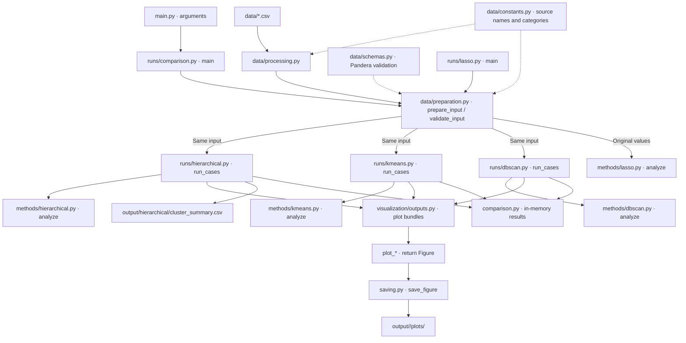

# Current file-level flow

`main.py` parses command-line arguments and delegates to `src/runs/comparison.py`. The coordinator requests `prepare_input` from `preparation.py`, which loads academic data through `processing.py`. It then calls `run_cases` in `runs/hierarchical.py`, `runs/kmeans.py` and `runs/dbscan.py`, passing the same in-memory input. Runs execute sequentially. Methods perform calculations; runs coordinate experiments, reporting and exports.

Each method independently groups the same feature matrix. Hierarchical labels are comparison outputs, never inputs to K-Means or DBSCAN.

## Common input

`ClusteringInput` contains original values, the standardized matrix, student identifiers and analysis date. Preparation uses sample standardization (`ddof=1`) and preserves all ten features, including dropout. Constants provide English names while their values match the original columns and categories. Pandera aliases retain original DataFrame names and order.

Preparation validates identities, row alignment, column contracts and finite values. Every method returns one label per row; DBSCAN uses `-1` for noise. Results contain group counts and means in original units, available Silhouette diagnostics and method-specific fields.

## Reference outputs

`generate_method_plots` dispatches common plots and hierarchical diagnostics. Plot functions return open figures; `save_figure` exports and closes them. Hierarchical outputs include the original-format summary CSV, linkage plots, a Silhouette-by-k curve, internal dendrograms and diagnostic zooms. These diagnostics do not change the fixed height-35 assignment.

DBSCAN's `run_cases` computes the requested individual fit and five fixed cases. It reuses a fit when its parameters match a fixed case, reports noise and concentration, and exports figures under `output/dbscan/experiments/`. The coordinator retains those cases as `dbscan_cases`. This is an explicit case protocol, not an automatic parameter search.

R-to-Python hierarchical equivalence is accepted on the verified inputs. Reconstructing publication values is not required. See the [study criteria](../criterios-del-trabajo.md).

## Independent K-Means experiments

`python -m src.runs.kmeans_experiments` prepares and validates the same ten-feature input, computes comparison references, and explores k and initialization counts across fixed seeds. It reuses Euclidean distances for Silhouette calculations on the shared matrix.

The run exports metrics, pairwise stability, assignments, profiles, intersection summaries and correspondence tables. `visualization/correspondence.py` returns the heatmap with counts and percentages normalized within hierarchical rows; `save_figure` exports it as `plots/correspondence.png`.

The main pipeline does not trigger the exploration. See the [K-Means experiment record](../resultados/experiencia-kmeans.md).

## Independent LASSO baseline

LASSO uses original values through the same preparation. Its coefficients neither select nor weight clustering features. Original R scripts and migration notebooks remain historical references under `Legacy/`.
