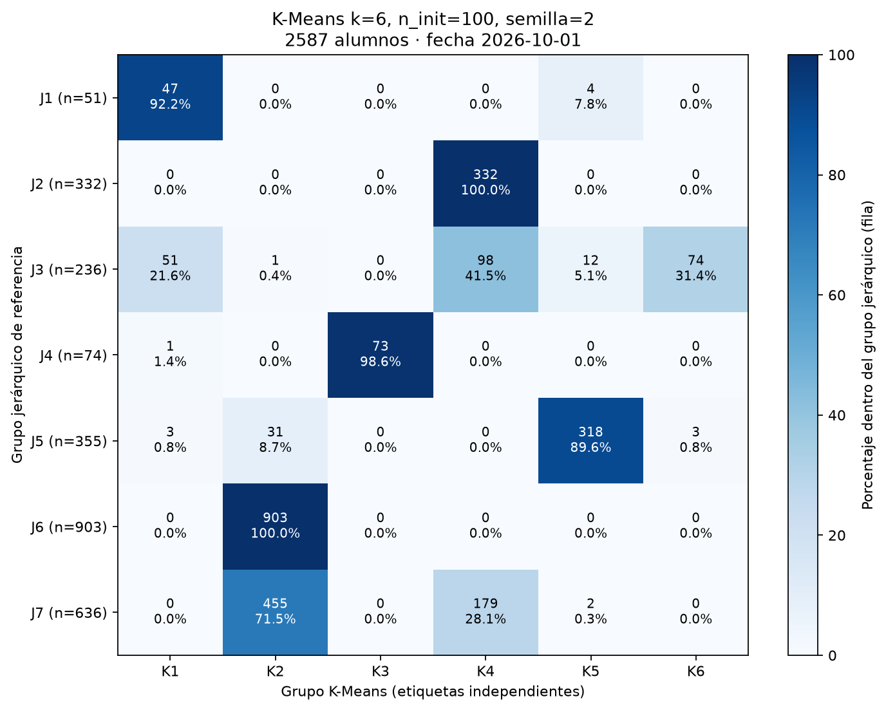
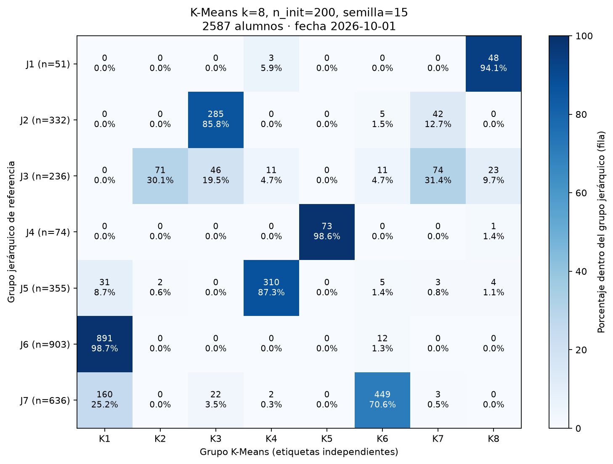

# Exploración de K-Means con los atributos originales

Ejecución del 11 de octubre de 2026, con fecha de análisis fija `2026-10-01`. Esta etapa compara agrupamientos e interpreta fragmentaciones y fusiones sobre la referencia jerárquica aceptada. Conserva los 2.587 alumnos y los diez atributos originales, incluido `deserto`, su orden y la estandarización muestral. No se retiraron ni ponderaron variables.

## Protocolo

Se conservó como referencia K-Means k=7, k-means++, 25 inicializaciones y semilla 123. La exploración probó k={5,6,7,8,9}, 100 inicializaciones y treinta semillas prefijadas: 123 y 0 a 28. Para k=7 y k=8 se agregó un control de 200 inicializaciones porque el ARI mínimo entre semillas quedó por debajo de 0,95. Este umbral operativo decide qué repetir; no define aceptación ni selecciona un ganador.

Se mantuvieron Lloyd, máximo de 300 iteraciones y tolerancia de 0,0001. Ningún ajuste exploratorio alcanzó ese límite; el máximo observado fue 36 iteraciones. Se realizaron 210 ajustes exploratorios y la referencia. Para cada k/n_init se exportó como representante el ajuste de menor inercia entre las treinta semillas, con desempate por el orden declarado de semillas. Esta elección facilita la interpretación y no equivale a elegir la mejor configuración académica.

Silhouette se calculó sobre todos los alumnos con distancia euclídea en el mismo espacio estandarizado. Se midió ARI entre todas las parejas de semillas de cada combinación, produciendo 3.045 comparaciones. También se emparejaron grupos del representante con los de cada semilla por máximo solapamiento uno a uno, para medir retención de integrantes y Jaccard (intersección/unión).

Estas mediciones estudian sensibilidad a la inicialización sobre una población fija. No evalúan estabilidad ante cambios de muestra ni predicción de deserción.

## Resultados globales

| k | n_init | ARI mínimo entre semillas | ARI mediano | Silhouette observado |
|---:|---:|---:|---:|---:|
| 5 | 100 | 0,994823 | 1,000000 | 0,454108–0,454603 |
| 6 | 100 | 0,993499 | 0,999146 | 0,464322–0,464749 |
| 7 | 100 | 0,859676 | 0,944924 | 0,364784–0,385514 |
| 7 | 200 | 0,930054 | 0,997565 | 0,376295–0,385514 |
| 8 | 100 | 0,812332 | 0,990151 | 0,364665–0,381768 |
| 8 | 200 | 0,968610 | 0,993968 | 0,364657–0,367533 |
| 9 | 100 | 0,968629 | 0,986220 | 0,361169–0,365800 |

Los resultados amplían y matizan el diagnóstico preliminar de diez semillas: con treinta aparecen variaciones adicionales de k=7 y k=8. El control de 200 inicializaciones mejora ambos; k=7 mantiene alternativas con composición distinta. k=5 y k=6 muestran gran concordancia entre las semillas estudiadas.

La inercia disminuye al aumentar k; esa propiedad no basta para preferir la solución de mayor cantidad de grupos. Un mayor Silhouette tampoco prueba utilidad institucional. La referencia principal sigue siendo k=7/n_init=25/semilla 123: Silhouette 0,365474 y ARI 0,670893 respecto del jerárquico.

## Seis grupos como candidato de síntesis

El representante k=6/n_init=100/semilla 2 permite describir perfiles diferenciados y reproducibles entre estas semillas:

| Grupo del representante | Alumnos | Finales aprobados, media | Cursadas desaprobadas, media | Promociones, media | Lectura académica |
|---|---:|---:|---:|---:|---|
| K1 | 102 | 10,17 | 23,08 | 0,56 | Avance intermedio con muchas desaprobaciones y alta antigüedad. |
| K2 | 1.390 | 0,80 | 1,67 | 0,03 | Muy bajo avance y pocas desaprobaciones registradas. |
| K3 | 73 | 14,00 | 13,11 | 2,74 | Mayor avance relativo y actividad de cursadas en 2023. |
| K4 | 609 | 0,69 | 9,09 | 0,09 | Muy bajo avance con más desaprobaciones y antigüedad. |
| K5 | 336 | 9,35 | 2,19 | 0,01 | Mayor rendimiento relativo en finales, pocas promociones. |
| K6 | 77 | 5,79 | 8,87 | 2,64 | Avance intermedio con promociones. |

Los números corresponden a este representante y no identifican los mismos grupos que otros ajustes ni que el PDF original. El grupo K3 conserva exactamente sus 73 integrantes entre las treinta semillas. El Jaccard mínimo por grupo respecto del representante varía entre 0,9481 y 1,0000.

La estabilidad no garantiza buena separación: K1 tiene Silhouette medio 0,1177 y 27,5 % de valores negativos; K6, 0,1276 y 24,7 %. Esos perfiles son reproducibles entre inicializaciones, pero sus fronteras son poco nítidas en la geometría estudiada.



El color y los porcentajes usan como denominador cada fila jerárquica. Una fila concentrada en una columna indica conservación de integrantes; una columna que reúne varias filas evidencia fusión.

## Qué revela la fragmentación de J3

Los 236 alumnos de J3 se reparten, con k=6, principalmente entre tres destinos:

| Fragmento de J3 | Alumnos | Finales aprobados, media | Cursadas desaprobadas, media | Promociones, media | Antigüedad media, días |
|---|---:|---:|---:|---:|---:|
| J3∩K4 | 98 | 3,09 | 12,70 | 0,41 | 4.540 |
| J3∩K6 | 74 | 5,80 | 8,80 | 2,69 | 3.157 |
| J3∩K1 | 51 | 7,65 | 25,10 | 0,53 | 4.942 |

Otros trece alumnos se reparten entre K2 y K5. Los fragmentos principales muestran diferencias de avance, promociones, desaprobaciones y antigüedad. Por tanto, la reorganización aporta una hipótesis académica concreta: la referencia J3 reúne trayectorias heterogéneas que K-Means distribuye hacia perfiles diferentes.

No todos los destinos están compuestos únicamente por alumnos de J3. Por ejemplo, K4 tiene 609 integrantes y recibe sólo 98 de J3: hay simultáneamente fragmentación de J3 y fusión con otros orígenes. Interpretar sólo las medias globales de K4 no describiría correctamente ese fragmento.

La estabilidad por grupo se mide sobre los destinos completos. Los CSV de asignaciones permiten estudiar adicionalmente la persistencia de cada intersección, sin asumir que la estabilidad global o la de los destinos equivale a estabilidad exacta de todos los fragmentos.

## Siete y ocho grupos: detalle adicional y sensibilidad

Con k=7/n_init=200, el grupo de 57 alumnos con promociones alcanza Jaccard mínimo de 0,5862 respecto del representante y Silhouette medio 0,0925. Aunque la mediana del Jaccard es 1, las ejecuciones alternativas cambian su composición. Otro grupo de 100 alumnos con muchas desaprobaciones tiene Jaccard mínimo 0,7727 y Silhouette medio 0,1100. Estos casos justifican cautela al consolidar perfiles pequeños de siete grupos.

Con k=8/n_init=200, la concordancia global mínima entre semillas mejora a 0,9686, pero esa cifra oculta variación en perfiles pequeños: K2, de 73 alumnos y promociones relativamente altas, tiene Jaccard mínimo 0,4487 y retención mínima 0,4795 respecto del representante. Por ello es un candidato para estudiar mayor detalle, con reservas sobre ese perfil. La interpretación debe revisar los perfiles y sus fronteras, en lugar de suponer que ocho grupos mejora automáticamente la segmentación. k=9 alcanza concordancia mínima similar con 100 inicializaciones, pero no supera la separación promedio de las soluciones de síntesis.



## Relación con el informe original

Se reconocen rasgos de los perfiles descritos por Clementi y Salias: mayor avance académico, rezago con desaprobaciones elevadas y trayectorias con distintos niveles de progreso. La comparación se realiza sobre el jerárquico actual verificado contra R, no sobre una identificación de alumnos o etiquetas reconstruida desde el PDF.

`deserto` se conserva como atributo de origen. Sus proporciones describen la composición de los grupos; no prueban predicción independiente ni causas de abandono. No se usa la retirada de esa variable como parte de la selección de K-Means.

La conclusión de esta etapa es que K-Means produce tanto núcleos conservados como redistribuciones con significado académico potencial. k=6 es un candidato de síntesis especialmente estable entre inicializaciones; k=8 con 200 inicializaciones ofrece un candidato de mayor detalle. Todavía no se adopta una configuración definitiva. Una siguiente etapa puede evaluar sensibilidad a submuestras e interpretar las distribuciones completas de los perfiles y las intersecciones relevantes.

## Reproducción y archivos

```bash
OMP_NUM_THREADS=1 OPENBLAS_NUM_THREADS=1 uv run python -m src.runs.kmeans_experiments --date 2026-10-01 --output output/k-means/exploration-2026-10-11
```

`protocol.json` conserva fecha, atributos, semillas, parámetros y huellas de la matriz, valores originales e identidad por posición. `metrics.csv`, `stability.csv` y `seed_pairs.csv` registran todos los ajustes y comparaciones. `all_assignments.csv` conserva las etiquetas alineadas por ID para reproducir cruces o análisis adicionales; permanece en `output/`, excluido de Git.

Cada carpeta de representante contiene medias, distribuciones, cuartiles, centros, Silhouette individual y por grupo, perfiles de intersecciones, tablas de correspondencias, fragmentación, fusión y persistencia entre semillas. Los gráficos de este registro se conservaron junto al documento para que no dependan exclusivamente de archivos ignorados por Git. Deben regenerarse si cambia la configuración que se documente en el informe final.

El protocolo conserva la referencia de `main.py`; la exploración se ejecuta sólo mediante el comando explícito. Los cambios de Python pasaron Ruff y 34 pruebas. No se modificaron los filtros, las variables ni DBSCAN.

La ejecución archivada del 11 de octubre conserva sus nombres de salida anteriores. La API actual utiliza rutas y metadatos en inglés; el comando de reproducción anterior genera la nueva estructura, manteniendo los mismos datos y resultados numéricos.
